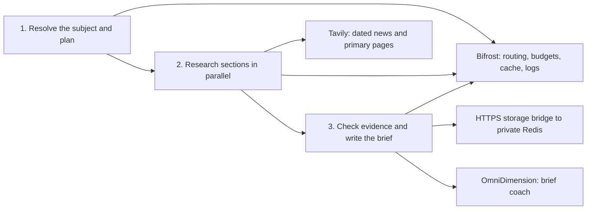

# PreMatch

[Open PreMatch](https://prematch-bay.vercel.app)

PreMatch researches a company or person before a meeting. It turns the last thirty days of public evidence into a dated runway, useful numbers, talking points, questions, and a printable brief. A voice coach can rehearse the conversation using the saved brief.

## How it works



Next.js consumes FastAPI server-sent events. LangGraph runs the stages. Bifrost stores configuration and logs in Postgres and semantic cache entries in Redis Stack. This app has its own virtual key, a monthly gateway budget, and a 60-request-per-minute gateway limit. Infrastructure charges are separate.

| Agent   | Responsibility                 | Primary model    | Effort |
| ------- | ------------------------------ | ---------------- | ------ |
| Cruyff  | Resolve the company or person  | Claude Haiku 5.5 | low    |
| Assist  | Plan purpose-specific research | Claude Haiku 5.5 | medium |
| Overlap | Extract findings per section   | Claude Haiku 5.5 | medium |
| VAR     | Check findings against sources | Claude Haiku 5.5 | low    |
| Golazo  | Write the meeting brief        | Claude Opus 5.5  | medium |

Bifrost fallbacks use GPT-6 Luna or GPT-6.1 Sol. The diagnostics drawer reports the served models, effort, request IDs, cache hits, and usage. Independent searches and section reviews run concurrently; duplicate queries share work. Search and extraction caches reduce repeat research, and only planning calls opt into the gateway cache.

The research window ends at the earlier of the meeting or the current date. Undated and out-of-window evidence cannot establish a finding. An official source or multiple source domains supports a verified label; one recognized outlet supports reported; other evidence remains unconfirmed. These labels describe sourcing, not a guarantee of truth or proof that outlets are editorially independent.

## Local setup

Use Node.js 22 or newer and Python 3.12.

```sh
npm ci
python3.12 -m venv .venv
.venv/bin/pip install -r requirements.txt
cp .env.example .env.local
```

Set `BIFROST_URL`, `BIFROST_VK`, and `TAVILY_API_KEY`. For persistent storage use `STORAGE_URL` and `STORAGE_TOKEN` for the authenticated HTTPS bridge, or `REDIS_URL` for local Redis. Production requires persistence; local development can use memory. Voice requires server-only `OMNIDIM_API_KEY` and `OMNIDIM_AGENT_ID`.

Run in separate terminals:

```sh
.venv/bin/uvicorn api.index:app --reload --port 8000
npm run dev
```

The frontend forwards `/api/py/*` to `PYTHON_API_URL`, defaulting to `http://127.0.0.1:8000`. Never place service keys in browser code or use a `NEXT_PUBLIC_` secret.

## API and verification

- `POST /api/py/brief`: streaming research and synthesis. Include `subject`, `subject_type`, timezone-aware `meeting_at`, `purpose`, and optional meeting context.
- `GET /api/py/runs/{id}`: saved brief and findings, retained for seven days.
- `GET /api/py/brief/{id}/text`: text export.
- `POST /api/py/voice/session`: create an ephemeral browser connection for a saved `brief_id`.
- `GET /api/py/health`: gateway and storage readiness.
- `/api/py/docs`: interactive API schema.

```sh
npm run lint
npm run typecheck
npm test
.venv/bin/python -m pytest api/tests -q
npm run build
```

`scripts/e2e_api.py --base URL --endpoint brief --input request.json` validates a complete live event stream and saved-brief retrieval. Two local live scenarios completed in 51.2 and 54.3 seconds; these are observed runs, not guarantees.

## Deployment and limits

Deploy this directory with `vercel deploy --prod` after configuring the server variables. The single Python entry point is `api/index.py`, with implementation modules in `backend/`. Railway hosts Bifrost, Postgres, private Redis, and the authenticated HTTPS storage bridge. Storage tokens isolate the apps.

The brief coach receives only the current brief context. It has no phone number or outbound-call capability. Microphone access is requested only after the visitor starts voice coaching. The voice SDK is loaded on demand.

Saved briefs are bearer links: anyone with the URL can view them until they expire. There is no account system. Research is limited to six runs per ten minutes and forty per day per client. The print view selects the most useful sections for a compact handout; the full brief remains available on screen. PDF output uses the browser print dialog. Validated synthesis items stream as the model writes the brief. Saved briefs are not continuously refreshed.

The hosted demo includes local snapshots. A clean clone works without them and hides the example picker.
